<!-- ════════════════════════ HEADER ════════════════════════ -->
<div align="center">


<br/>

<a href="https://luxmohamet.uz"></a>


</div>

<br/>

<!-- ════════════════════════ ABOUT ════════════════════════ -->
## `> whoami`

```csharp
public sealed class Nurmuhammad : SoftwareEngineer
{
    public string   Location  => "Tashkent, Uzbekistan";
    public string   Company   => "LETI EDU";
    public string[] Backend   => [ "C#", "ASP.NET Core", "EF Core", "PostgreSQL" ];
    public string[] Frontend  => [ "TypeScript", "Next.js", "Angular" ];
    public string[] Practices => [ "Clean Architecture", "Microservices", "REST", "JWT" ];
    public string   Focus     => "Reliable backends and AI tools for education";
}
```

<br/>

<!-- ════════════════════════ STACK ════════════════════════ -->
## `> tech-stack`

<div align="center">

**Languages**<br/>


**Frameworks**<br/>


**Data · DevOps · Tools**<br/>


</div>

<br/>

<!-- ════════════════════════ PROJECTS ════════════════════════ -->
## `> featured-projects`

<table>
<tr>
<td width="50%" valign="top">

#### [Leti AI Mentor](https://github.com/nurmuhammad-sharobiddinov/leti-ai-mentor)
Leti maktabi uchun AI matematika mentori — Telegram bot. Mavzuni sodda tushuntiradi, test o'tkazadi va natijani tahlil qiladi. Clean Architecture asosida yozilgan.


</td>
<td width="50%" valign="top">

#### [Karvon Stroy](https://github.com/nurmuhammad-sharobiddinov/karvonstroy)
Turar-joy majmualari platformasi: loyihalar katalogi, interaktiv shaxmatka orqali kvartira tanlash, ipoteka kalkulyatori va onlayn xarid.


</td>
</tr>
<tr>
<td width="50%" valign="top">

#### [Exam Microservice](https://github.com/nurmuhammad-sharobiddinov/Exam-Microservice)
Mikroservis arxitekturasidagi imtihon tizimi. Servislar alohida konteynerlarda ishlaydi.


</td>
<td width="50%" valign="top">

#### [API Gateway](https://github.com/nurmuhammad-sharobiddinov/ApiGetawey)
Mikroservislar uchun yagona kirish nuqtasi — so'rovlarni marshrutlash va servislarni birlashtirish.


</td>
</tr>
</table>

<br/>

<!-- ════════════════════════ STATS ════════════════════════ -->
## `> github-stats`

<div align="center">





</div>

<br/>

<!-- ════════════════════════ SNAKE ════════════════════════ -->
<div align="center">

<picture>
  <source media="(prefers-color-scheme: dark)" srcset="https://raw.githubusercontent.com/nurmuhammad-sharobiddinov/nurmuhammad-sharobiddinov/output/github-snake-dark.svg"/>
  <source media="(prefers-color-scheme: light)" srcset="https://raw.githubusercontent.com/nurmuhammad-sharobiddinov/nurmuhammad-sharobiddinov/output/github-snake.svg"/>
  
</picture>

</div>

<!-- ════════════════════════ CONTACT ════════════════════════ -->
## `> contact`

<div align="center">

<a href="https://www.linkedin.com/in/nurmuhammadsharobiddinov/"></a>
<a href="https://www.instagram.com/mrluxdev/"></a>
<a href="https://luxmohamet.uz"></a>

</div>


